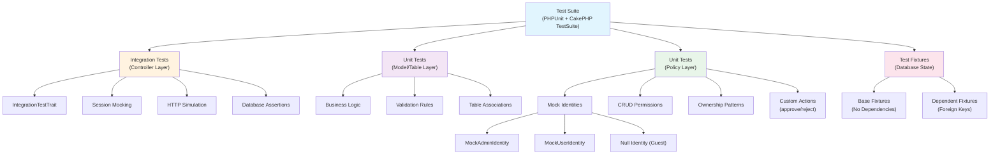
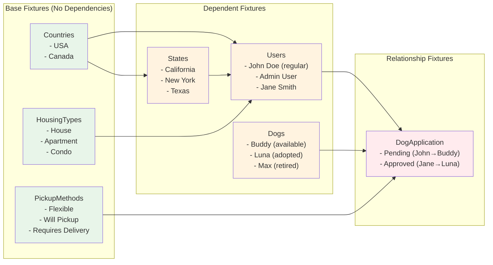
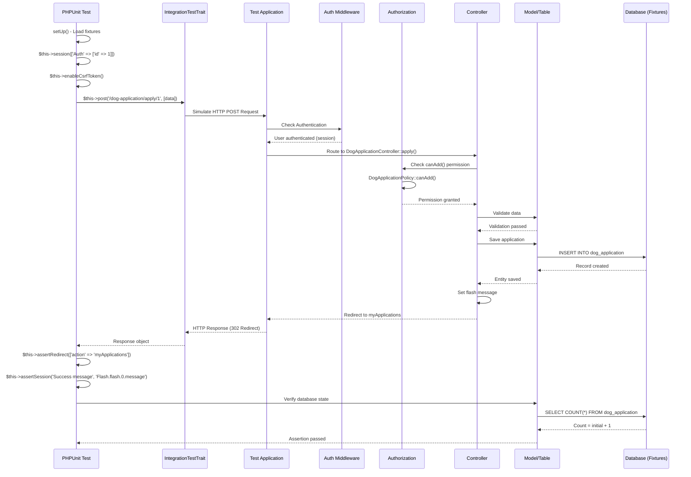

# Testing Architecture & Patterns

**Last Updated:** November 1, 2025

This document provides comprehensive documentation of the testing architecture, patterns, and best practices used in the Hannah's Haus Cake application. The test suite ensures reliability, maintainability, and proper authorization throughout the dog adoption management system.

## Overview

The Hannah's Haus Cake application employs a comprehensive testing strategy utilizing PHPUnit and CakePHP's TestSuite framework. Our testing philosophy emphasizes:

- **Full HTTP lifecycle testing** for controllers using integration tests
- **Isolated unit testing** for business logic in models and authorization policies
- **Fixture-based data management** with careful dependency ordering
- **Mock identity patterns** for authorization testing
- **100% coverage** of critical user workflows (registration, adoption applications, approvals)

### Test Statistics

- **Total test files:** 22 (13 controller, 6 model, 3 policy)
- **Total fixtures:** 7 with carefully managed dependencies
- **Example coverage:** DogApplicationControllerTest - 431 lines, 12 test methods
- **Policy coverage:** DogApplicationPolicyTest - 589 lines, 18 test methods

## Test Architecture

The testing architecture follows a hierarchical structure with clear separation of concerns:



### Test Types Explanation

**Integration Tests (Controller)**
- Use `IntegrationTestTrait` to simulate full HTTP request/response cycles
- Test authentication requirements, authorization checks, and complete workflows
- Verify database state changes, redirects, and flash messages
- Located in `tests/TestCase/Controller/`

**Unit Tests (Model/Table)**
- Test business logic methods in isolation
- Verify validation rules and data transformations
- Test table associations and query methods
- Located in `tests/TestCase/Model/Table/`

**Unit Tests (Policy)**
- Test authorization rules using mock identities
- Cover all CRUD operations and custom actions
- Test three identity types: Guest (null), User, Admin
- Verify ownership-based permissions
- Located in `tests/TestCase/Policy/`

## Fixture Management

Fixtures provide consistent test data with carefully managed dependencies to respect foreign key constraints:



### Fixture Loading Order

The loading order is critical due to foreign key constraints:

1. **Base lookups** (no foreign keys): Countries, HousingTypes, PickupMethods
2. **Dependent lookups**: States (depends on Countries)
3. **Domain entities**: Users (depends on Countries, States, HousingTypes), Dogs
4. **Relationships**: DogApplication (depends on Users, Dogs, PickupMethods)

### Adding New Fixtures

When creating new fixtures:
1. Identify all foreign key dependencies
2. Add to fixture array in dependency order
3. Provide realistic test data with clear comments
4. Document the purpose of each record

Example from `DogApplicationFixture.php`:
```php
protected $fixtures = [
    'app.Countries',        // Base lookup
    'app.HousingTypes',     // Base lookup
    'app.PickupMethods',    // Base lookup
    'app.States',           // Depends on Countries
    'app.Users',            // Depends on Countries, States, HousingTypes
    'app.Dogs',             // Independent
    'app.DogApplication',   // Depends on Users, Dogs, PickupMethods
];
```

## Controller Integration Testing

Integration tests simulate the complete HTTP request lifecycle, including routing, middleware, controller actions, and database operations:



### Pattern Explanation

```php
class DogApplicationControllerTest extends TestCase
{
    use IntegrationTestTrait;

    protected $fixtures = [/* ... in dependency order ... */];

    public function testApplyPostWithValidData(): void
    {
        // 1. Authentication mocking
        $this->session(['Auth' => ['id' => 3, 'email' => 'jane@example.com']]);

        // 2. CSRF protection
        $this->enableCsrfToken();

        // 3. Capture initial state
        $applicationsBefore = $this->getTableLocator()
            ->get('DogApplication')
            ->find()
            ->count();

        // 4. Simulate HTTP request
        $this->post('/dog-application/apply/1', [
            'pickupMethodId' => 1,
        ]);

        // 5. Assert response
        $this->assertRedirect(['action' => 'myApplications']);

        // 6. Assert flash messages
        $this->assertSession('Your adoption application has been submitted successfully!', 'Flash.flash.0.message');

        // 7. Assert database changes
        $applicationsAfter = $this->getTableLocator()
            ->get('DogApplication')
            ->find()
            ->count();
        $this->assertEquals($applicationsBefore + 1, $applicationsAfter);
    }
}
```

### HTTP Assertions Reference

- `assertResponseOk()` - Response has 200 status
- `assertResponseCode(302)` - Specific status code
- `assertRedirect($url)` - Verify redirect location
- `assertSession($value, $key)` - Check session data
- `assertResponseContains($text)` - Body contains text
- `viewVariable($name)` - Access controller view variables

### Best Practices

1. **Always load fixtures in dependency order** to avoid foreign key constraint violations
2. **Mock authentication** using `$this->session()` for user context
3. **Enable CSRF** for POST/PUT/DELETE requests: `$this->enableCsrfToken()`
4. **Capture state before and after** operations for database assertions
5. **Test both success and failure paths** including validation errors
6. **Verify complete workflow** including redirects and flash messages

## Policy Authorization Testing

Policy tests verify authorization rules using mock identities and various resource states:

```mermaid
flowchart TD
    Start([Test Method Starts])
    CreateIdentity[Create Mock Identity]
    CreateResource[Create Mock Resource Entity]

    Start --> CreateIdentity
    Start --> CreateResource

    CreateIdentity --> IdentityType{Identity Type?}
    IdentityType -->|Admin| AdminIdentity[MockAdminIdentity<br/>get('isAdmin') = true]
    IdentityType -->|User| UserIdentity[MockUserIdentity<br/>get('isAdmin') = false]
    IdentityType -->|Guest| NullIdentity[null identity]

    CreateResource --> ResourceSetup[Set Resource Properties<br/>- userId (owner)<br/>- approved status<br/>- other attributes]

    AdminIdentity --> CallPolicy
    UserIdentity --> CallPolicy
    NullIdentity --> CallPolicy
    ResourceSetup --> CallPolicy

    CallPolicy[Call Policy Method<br/>canView/canEdit/canDelete/etc]

    CallPolicy --> PolicyLogic{Policy Logic}

    PolicyLogic --> IsAdmin{Is Admin?}
    IsAdmin -->|Yes| ReturnTrue[Return true]
    IsAdmin -->|No| CheckOwnership{Is Owner?}

    CheckOwnership -->|Yes| CheckStatus{Check Status}
    CheckOwnership -->|No| ReturnFalse[Return false]

    CheckStatus -->|Pending| AllowEdit[Return true for edit]
    CheckStatus -->|Approved/Rejected| DenyEdit[Return false for edit]

    ReturnTrue --> Assert[Assert Result]
    ReturnFalse --> Assert
    AllowEdit --> Assert
    DenyEdit --> Assert

    Assert --> End([Test Complete])

    style Start fill:#e8f5e9
    style End fill:#e8f5e9
    style ReturnTrue fill:#c8e6c9
    style ReturnFalse fill:#ffcdd2
```

### Mock Identity Pattern

```php
class MockAdminIdentity implements IdentityInterface
{
    private $userId;

    public function __construct(int $userId = 2)
    {
        $this->userId = $userId;
    }

    public function getIdentifier()
    {
        return $this->userId;
    }

    public function get(string $field)
    {
        if ($field === 'isAdmin') {
            return true;  // Key difference: Admin returns true
        }
        return null;
    }
}

class MockUserIdentity implements IdentityInterface
{
    // ... similar structure ...
    public function get(string $field)
    {
        if ($field === 'isAdmin') {
            return false;  // Regular user returns false
        }
        return null;
    }
}
```

### Test Scenarios to Cover

For each policy method, test these scenarios:

1. **Guest Access** - null identity
2. **User Own Resource** - User accessing their own data
3. **User Other's Resource** - User accessing another user's data
4. **Admin Access** - Admin accessing any data
5. **Status Variations** - Different resource states (pending/approved/rejected)

Example test structure:
```php
public function testCanEditOwnPendingApplication(): void
{
    $user = $this->createUserIdentity(1);
    $application = $this->createApplication(1, '0'); // Owned by user 1, pending

    $result = $this->policy->canEdit($user, $application);

    $this->assertTrue($result, 'Users should be able to edit their own pending applications');
}
```

### Custom Action Testing

For non-CRUD actions like `canApprove()` and `canReject()`:

```php
public function testCanApproveAsAdmin(): void
{
    $admin = $this->createAdminIdentity(2);
    $application = $this->createApplication(1, '0'); // Pending

    $result = $this->policy->canApprove($admin, $application);

    $this->assertTrue($result, 'Admins should be able to approve applications');
}
```

## Model/Table Unit Testing

Model tests verify business logic, validation rules, and database interactions:

### Purpose and Scope

- **Validation Testing**: Ensure field validation rules work correctly
- **Association Testing**: Verify table relationships (hasMany, belongsTo)
- **Business Logic Testing**: Test custom finder methods and data transformations
- **Default Values**: Verify default values are set correctly

### Example Patterns

```php
class UsersTableTest extends TestCase
{
    protected $fixtures = ['app.Users', 'app.Countries', 'app.States', 'app.HousingTypes'];

    public function testValidationDefault(): void
    {
        $user = $this->Users->newEmptyEntity();
        $user = $this->Users->patchEntity($user, [
            'email' => 'invalid-email',  // Invalid format
            'password' => 'weak',         // Too short
        ]);

        $this->assertFalse($this->Users->save($user));
        $this->assertNotEmpty($user->getErrors());
    }

    public function testFindActive(): void
    {
        $query = $this->Users->find('active');
        $this->assertInstanceOf('Cake\ORM\Query', $query);

        $result = $query->toArray();
        $this->assertCount(2, $result);  // Based on fixture data
    }
}
```

## Test Data Management

### Fixture File Structure

Each fixture provides specific test scenarios:

```php
class DogApplicationFixture extends TestFixture
{
    public $table = 'dog_application';

    public function init(): void
    {
        $this->records = [
            // Pending application - main testing scenario
            [
                'id' => 1,
                'userId' => 1,        // John Doe
                'dogId' => 1,         // Buddy (available dog)
                'pickupMethodId' => 1, // Flexible
                'dateCreated' => '2024-01-05 14:30:00',
                'approved' => '0',    // Pending status
                'approvedDate' => null,
            ],
            // Approved application - for "already applied" testing
            [
                'id' => 2,
                'userId' => 3,        // Jane Smith
                'dogId' => 2,         // Luna (adopted dog)
                'pickupMethodId' => 2, // Will Pickup
                'dateCreated' => '2024-01-03 10:00:00',
                'approved' => '1',    // Approved status
                'approvedDate' => '2024-01-04 15:00:00',
            ],
        ];
        parent::init();
    }
}
```

### Realistic vs. Minimal Test Data

- **Realistic data** for integration tests (complete user profiles, valid relationships)
- **Minimal data** for unit tests (only required fields)
- **Edge cases** represented (retired dogs, adopted dogs, rejected applications)
- **Clear comments** explaining each record's purpose

## Running Tests

### Command Reference

**Run all tests:**
```bash
composer test
# or
vendor/bin/phpunit
```

**Run specific test file:**
```bash
vendor/bin/phpunit tests/TestCase/Controller/DogApplicationControllerTest.php
```

**Run specific test method:**
```bash
vendor/bin/phpunit tests/TestCase/Controller/DogApplicationControllerTest.php --filter testApplyPostWithValidData
```

**Run with code coverage:**
```bash
vendor/bin/phpunit --coverage-html webroot/coverage
```

### Docker Commands

When running in Docker containers:

```bash
# Run all tests in Docker
docker exec -it myapp-webserver vendor/bin/phpunit

# Run specific test in Docker
docker exec -it myapp-webserver vendor/bin/phpunit tests/TestCase/Controller/UsersControllerTest.php

# Interactive shell for debugging
docker exec -it myapp-webserver bash
```

## Best Practices

### Fixture Loading Order

Always load fixtures in dependency order to satisfy foreign key constraints:

```php
protected $fixtures = [
    // 1. Base lookups first (no foreign keys)
    'app.Countries',
    'app.HousingTypes',
    'app.PickupMethods',

    // 2. Dependent lookups
    'app.States',  // Depends on Countries

    // 3. Domain entities
    'app.Users',   // Depends on Countries, States, HousingTypes
    'app.Dogs',

    // 4. Relationships last
    'app.DogApplication',  // Depends on Users, Dogs, PickupMethods
];
```

### Test Naming Conventions

Follow the pattern: `test` + `MethodName` + `Scenario`

Examples:
- `testApplyRequiresAuthentication`
- `testApplyWithInvalidDogId`
- `testCanEditOwnPendingApplication`
- `testCannotEditOwnApprovedApplication`

### Assertion Best Practices

1. **Use specific assertions**: `assertEquals()` instead of `assertTrue($a == $b)`
2. **Include failure messages**: Third parameter explains what should happen
3. **Test one thing per test**: Keep tests focused and simple
4. **Assert preconditions**: Verify initial state before testing changes
5. **Test edge cases**: Empty results, null values, boundary conditions

### Mock vs. Real Dependencies

- **Use mocks for**: External services, email sending, file uploads
- **Use real for**: Database operations (with fixtures), validation, authorization
- **Integration tests**: Use real dependencies to test full stack
- **Unit tests**: Mock only what's necessary to isolate the unit

### Test Isolation

Each test should:
1. Set up its own state (don't rely on test order)
2. Clean up after itself (fixtures handle database reset)
3. Not affect other tests (avoid static state)
4. Be runnable independently

## Common Patterns Reference

### Authentication Mocking

```php
// Mock authenticated user
$this->session(['Auth' => ['id' => 1, 'email' => 'user@example.com']]);

// Mock admin user
$this->session(['Auth' => ['id' => 2, 'email' => 'admin@example.com', 'isAdmin' => true]]);

// Test unauthenticated access (no session call)
```

### Database State Assertions

```php
// Count records before and after
$before = $this->getTableLocator()->get('TableName')->find()->count();
// ... perform action ...
$after = $this->getTableLocator()->get('TableName')->find()->count();
$this->assertEquals($before + 1, $after);

// Verify specific record exists
$record = $this->getTableLocator()->get('TableName')
    ->find()
    ->where(['field' => 'value'])
    ->first();
$this->assertNotNull($record);
$this->assertEquals('expected', $record->field);
```

### Policy Testing Scenarios

```php
// Test matrix for each policy method:
public function dataProviderForCanView(): array
{
    return [
        'admin can view any' => [true, 'admin', 1, 2],      // Admin viewing other's
        'user can view own' => [true, 'user', 1, 1],        // User viewing own
        'user cannot view others' => [false, 'user', 1, 2], // User viewing other's
        'guest cannot view' => [false, null, null, 1],      // Guest viewing any
    ];
}
```

### Integration Test Assertions

```php
// Response assertions
$this->assertResponseOk();                                    // 200 status
$this->assertResponseCode(302);                              // Specific status
$this->assertRedirect(['controller' => 'Dogs', 'action' => 'index']);
$this->assertResponseContains('Welcome');                    // Body content

// Session/Flash assertions
$this->assertSession('Error message', 'Flash.flash.0.message');
$this->assertSession(1, 'Auth.id');

// View variable assertions
$dog = $this->viewVariable('dog');
$this->assertNotNull($dog);
$this->assertEquals('Buddy', $dog->name);
```

## Related Code References

### Test Files
- `tests/TestCase/Controller/` - Integration tests for all controllers
- `tests/TestCase/Model/Table/` - Unit tests for table classes
- `tests/TestCase/Policy/` - Authorization policy tests
- `tests/Fixture/` - Test data fixtures

### Configuration
- `tests/bootstrap.php` - Test environment configuration
- `phpunit.xml.dist` - PHPUnit configuration
- `composer.json` - Test scripts and dependencies

### Framework Documentation
- [CakePHP Testing Documentation](https://book.cakephp.org/4/en/development/testing.html)
- [PHPUnit Documentation](https://phpunit.de/documentation.html)
- [CakePHP Authorization Testing](https://book.cakephp.org/authorization/2/en/index.html)

## See Also

- [CLAUDE.md Testing Section](/CLAUDE.md#common-commands) - Project-specific testing commands
- [Architecture Overview](/docs/architecture/) - System architecture documentation
- [Development Workflow](/docs/workflows/) - Development process documentation