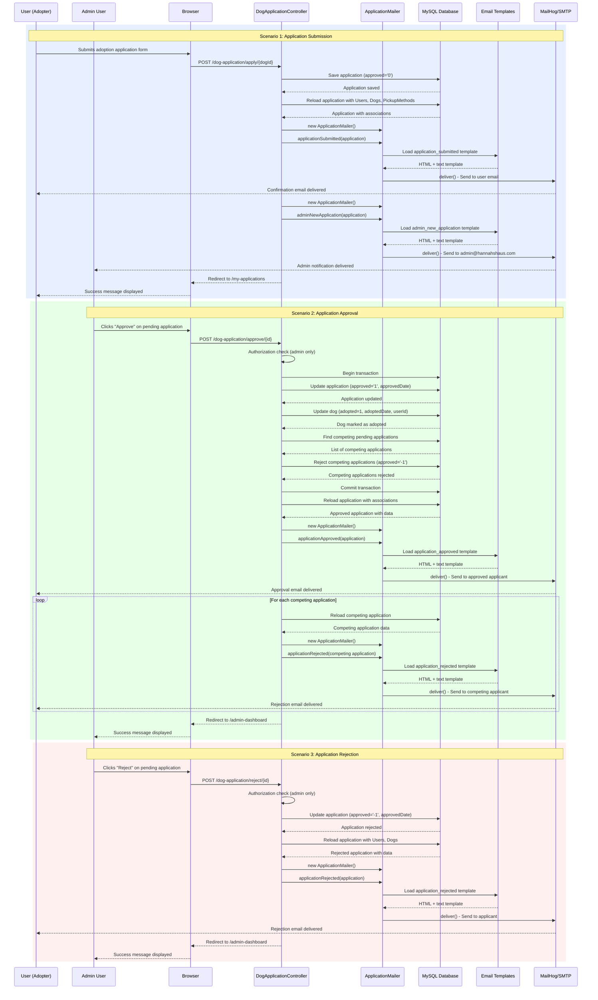
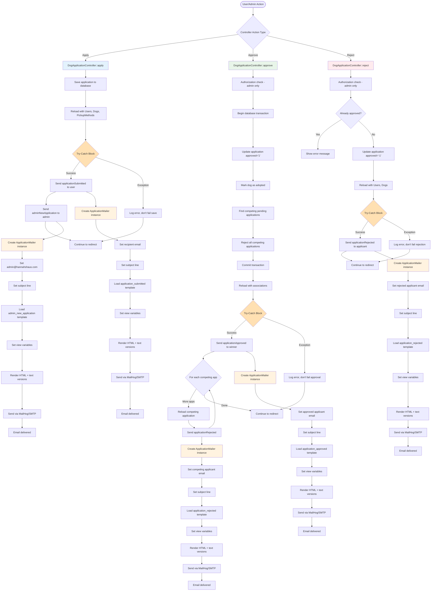

# Email Notification System

**Last Updated:** 2025-11-02

This document describes the complete email notification system for adoption application workflows in the Hannah's Haus Cake dog adoption application.

## Overview

The Hannah's Haus Cake application sends automated email notifications at critical points in the adoption workflow. These notifications keep applicants informed about their application status and alert administrators when new applications require review. The system uses CakePHP's Mailer component with professional HTML/text email templates and is configured to use MailHog for development testing.

All email functionality is centralized in the `ApplicationMailer` class, which provides four distinct notification types covering the entire adoption lifecycle from submission through final approval or rejection.

## Email Notification Scenarios

### 1. Application Submission
When a user submits an adoption application, the system sends:
- **Confirmation email to applicant**: Acknowledges receipt and explains the review timeline
- **Notification email to admin**: Alerts the admin team with applicant details for review

### 2. Application Approval
When an admin approves an application, the system sends:
- **Approval email to successful applicant**: Congratulates them and provides next steps
- **Rejection emails to competing applicants**: Automatically sent to all other pending applicants for the same dog

### 3. Application Rejection
When an admin rejects an application, the system sends:
- **Rejection email to applicant**: Empathetic notification with encouragement to apply for other dogs

### 4. Admin Notifications
Admins receive notifications when:
- **New application submitted**: Complete applicant profile summary for review

## Email Notification Flow

This sequence diagram illustrates all four email notification scenarios and their interactions between users, controllers, the mailer system, and email delivery infrastructure.



## ApplicationMailer Architecture

This flowchart illustrates the complete architecture of the email notification system, showing how controller actions integrate with the ApplicationMailer class, templates, and transport layer.



## ApplicationMailer Class

**Location:** `src/Mailer/ApplicationMailer.php`

The `ApplicationMailer` class extends CakePHP's `Mailer` class and provides four specialized methods for sending adoption-related email notifications. Each method handles lazy loading of associations to ensure all required data is available for email templates.

### Method Reference

#### applicationSubmitted(DogApplication $application)

**Purpose:** Send confirmation email to applicant after application submission

**Recipient:** Applicant email address (`$application->user->email`)

**Subject:** "Adoption Application Received for {dogName}"

**Template:** `application_submitted` (HTML + text versions)

**Associations Required:**
- Users
- Dogs
- PickupMethods

**View Variables:**
- `application` - Complete application entity
- `applicantName` - Full name (fname + lname)
- `dogName` - Name of the dog applied for

**Code Location:** `src/Mailer/ApplicationMailer.php:33-52`

---

#### applicationApproved(DogApplication $application)

**Purpose:** Send celebratory approval notification to successful applicant

**Recipient:** Approved applicant email address (`$application->user->email`)

**Subject:** "Your Adoption Application Has Been Approved!"

**Template:** `application_approved` (HTML + text versions)

**Associations Required:**
- Users
- Dogs
- PickupMethods

**View Variables:**
- `application` - Complete application entity
- `applicantName` - Full name (fname + lname)
- `dogName` - Name of the dog
- `pickupMethod` - Selected pickup/delivery method name

**Code Location:** `src/Mailer/ApplicationMailer.php:63-83`

---

#### applicationRejected(DogApplication $application)

**Purpose:** Send empathetic rejection notification with encouragement

**Recipient:** Rejected applicant email address (`$application->user->email`)

**Subject:** "Adoption Application Update for {dogName}"

**Template:** `application_rejected` (HTML + text versions)

**Associations Required:**
- Users
- Dogs

**View Variables:**
- `application` - Complete application entity
- `applicantName` - Full name (fname + lname)
- `dogName` - Name of the dog

**Code Location:** `src/Mailer/ApplicationMailer.php:94-113`

---

#### adminNewApplication(DogApplication $application)

**Purpose:** Alert admin team about new application requiring review

**Recipient:** `admin@hannahshaus.com` (hardcoded, TODO: move to configuration)

**Subject:** "New Adoption Application for Review - {dogName}"

**Template:** `admin_new_application` (HTML + text versions)

**Associations Required:**
- Users
- Users.HousingTypes
- Users.States
- Users.Countries
- Dogs
- PickupMethods

**View Variables:**
- `application` - Complete application entity
- `applicantName` - Full name (fname + lname)
- `dogName` - Name of the dog
- `applicantEmail` - Applicant's email address
- `applicantPhone` - Applicant's phone number (or "Not provided")
- `housingType` - Type of housing (house, apartment, etc.)
- `hasChildren` - Whether applicant has children
- `everOwnedDogs` - Previous dog ownership experience
- `primaryCareTaker` - Whether applicant will be primary caretaker

**Code Location:** `src/Mailer/ApplicationMailer.php:124-159`

---

### Lazy Loading Pattern

The ApplicationMailer uses a lazy loading pattern to ensure all required associations are available for email templates. Each method checks if the `user` association is loaded:

```php
if (!isset($application->user)) {
    $table = TableRegistry::getTableLocator()->get('DogApplication');
    $table->loadInto($application, ['Users', 'Dogs', 'PickupMethods']);
}
```

This design allows the mailer to work correctly even if the calling code forgets to load associations, preventing template rendering errors.

### Error Handling

All email operations in the controller are wrapped in try-catch blocks to ensure that email delivery failures do not cause application operations to fail:

```php
try {
    $mailer = new ApplicationMailer();
    $mailer->applicationSubmitted($application)->deliver();
} catch (\Exception $e) {
    Log::error('Failed to send application emails: ' . $e->getMessage());
}
```

This approach prioritizes data integrity - applications are always saved/approved/rejected successfully, with email failures logged for investigation but not presented to users as errors.

## Email Templates

### Template Structure

All emails have both HTML and plain text versions to ensure compatibility across email clients. The HTML versions feature professional responsive designs with inline CSS for maximum compatibility, while text versions provide clean, readable content for terminal-based email clients.

Template files are organized in two directories:
- **HTML templates:** `templates/email/html/`
- **Text templates:** `templates/email/text/`

Each email template receives view variables from the corresponding ApplicationMailer method and uses CakePHP's templating syntax for dynamic content.

### Template Locations

**HTML Templates:**
1. `templates/email/html/application_submitted.php`
2. `templates/email/html/application_approved.php`
3. `templates/email/html/application_rejected.php`
4. `templates/email/html/admin_new_application.php`

**Text Templates:**
1. `templates/email/text/application_submitted.php`
2. `templates/email/text/application_approved.php`
3. `templates/email/text/application_rejected.php`
4. `templates/email/text/admin_new_application.php`

### Template Details

#### application_submitted

**Purpose:** Confirmation to applicant after submission

**Design:**
- Purple gradient header (linear-gradient from #667eea to #764ba2)
- "Application Received!" headline in white text
- Gray application summary card with left purple border
- Three-step numbered process explaining what happens next
- Link to "My Applications" page for status tracking
- Contact information footer

**Key Features:**
- Personalized greeting with applicant name
- Application summary showing dog name, submission date, and pickup method
- Clear timeline expectations (review within 3-5 business days)
- Professional, reassuring tone
- Responsive table-based layout for email client compatibility

**Location:** `templates/email/html/application_submitted.php`

---

#### application_approved

**Purpose:** Celebratory approval notification

**Design:**
- Green gradient header (linear-gradient from #28a745 to #20c997)
- Large party popper emoji (🎉)
- "Congratulations!" headline with subheading about approval
- Green success box with "Welcome to the Family!" message
- Four detailed next-step cards with numbered circular badges
- Yellow warning box emphasizing 48-hour response requirement
- Warm closing message from "The Hannah's Haus Team"

**Key Features:**
- Highly visual celebration design to convey excitement
- Detailed action items: contact coordinator, schedule pickup, prepare home, sign agreement
- Contact information for adoption coordinator with phone and email
- Pickup method reminder
- Urgent call-to-action (respond within 48 hours)
- Professional but warm and enthusiastic tone

**Location:** `templates/email/html/application_approved.php`

---

#### application_rejected

**Purpose:** Empathetic rejection with encouragement

**Design:**
- Gray neutral header (subtle gradient avoiding harsh colors)
- Empathetic opening acknowledging disappointment
- Explanation that another applicant was selected
- Blue encouragement box with positive messaging
- Suggestions to browse other available dogs
- Link to dogs listing page
- Supportive closing emphasizing continued welcome

**Key Features:**
- Sensitive, respectful tone avoiding blame or negativity
- Acknowledgment of applicant's disappointment
- Clear explanation of selection process
- Encouragement to apply again for other dogs
- Link to available dogs to facilitate continued engagement
- Professional but compassionate messaging

**Location:** `templates/email/html/application_rejected.php`

---

#### admin_new_application

**Purpose:** Alert admin to review new application

**Design:**
- Orange alert header (linear-gradient from #ff6b6b to #f39c12)
- "New Application for Review" headline with bell icon
- Detailed applicant information table with key details
- Dog information section
- Application metadata (submission date, pickup method)
- Call-to-action link to admin dashboard
- Professional admin-focused layout

**Key Features:**
- Comprehensive applicant profile: name, email, phone, housing details
- Housing suitability indicators: has children, dog ownership history, primary caretaker
- Dog details and pickup preference
- Direct link to admin dashboard for quick action
- Scannable table format for rapid review
- Clear, business-focused tone

**Location:** `templates/email/html/admin_new_application.php`

## Email Configuration

### Development (Current)

**Transport:** MailHog

**Configuration Location:** `config/app.php:260-268`

**SMTP Settings:**
- **Host:** `hannahs_haus_mailhog` (Docker service name)
- **Port:** 1025
- **TLS:** Disabled
- **Authentication:** None required

**Web UI:** http://localhost:8025

**Email Profile:** `config/app.php:306-313`
- **Transport:** `mailhog`
- **From Address:** `noreply@hannahshaus.com`
- **From Name:** "Hannah's Haus Dog Adoption"
- **Charset:** UTF-8

**Benefits:**
- Zero configuration required for development
- Web UI for viewing all sent emails
- No risk of accidentally sending emails to real users
- Perfect for testing template rendering and content
- Automatically captures all outgoing mail

### Production (Future)

**Transport:** AWS SES (currently commented out)

**Configuration Location:** `config/app.php:285-294`

**SMTP Settings (Example for us-east-1):**
- **Host:** `email-smtp.us-east-1.amazonaws.com`
- **Port:** 587
- **TLS:** Enabled
- **Username:** Set via `AWS_SES_USERNAME` environment variable
- **Password:** Set via `AWS_SES_PASSWORD` environment variable

**Required Setup Steps:**

1. **Verify Sender Emails in AWS SES Console**
   - Verify `noreply@hannahshaus.com`
   - Verify `admin@hannahshaus.com`
   - Verify `adoptions@hannahshaus.com`

2. **Request Production Access**
   - AWS SES starts in sandbox mode (can only send to verified addresses)
   - Submit production access request to send to any email address
   - Explain use case and sending patterns

3. **Set Environment Variables**
   ```bash
   export AWS_SES_USERNAME='your-ses-smtp-username'
   export AWS_SES_PASSWORD='your-ses-smtp-password'
   ```

4. **Update Email Profile**
   - Uncomment AWS SES transport configuration in `config/app.php`
   - Change Email profile transport from `mailhog` to `ses`
   - Update from addresses if using custom domain

5. **Configure SPF and DKIM Records**
   - Add AWS SES SPF record to DNS: `v=spf1 include:amazonses.com ~all`
   - Configure DKIM signing in AWS SES console
   - Add DKIM CNAME records to DNS

**Region-Specific SMTP Endpoints:**
- **us-east-1:** email-smtp.us-east-1.amazonaws.com
- **us-west-2:** email-smtp.us-west-2.amazonaws.com
- **eu-west-1:** email-smtp.eu-west-1.amazonaws.com

## Testing Email Notifications

### Using MailHog

MailHog is a development email testing tool that captures all outgoing emails and displays them in a web interface. This allows developers to test email functionality without sending real emails.

#### 1. Start MailHog

Ensure MailHog container is running:

```bash
docker-compose up -d
```

Verify MailHog is running:

```bash
docker ps | grep mailhog
```

Expected output:
```
hannahs_haus_mailhog   mailhog/mailhog   running   0.0.0.0:8025->8025/tcp, 1025/tcp
```

#### 2. Access MailHog UI

Open your browser to: **http://localhost:8025**

You will see the MailHog interface with:
- List of captured emails on the left
- Email preview pane on the right
- Search and filter capabilities

#### 3. Trigger Email Scenarios

**Scenario 1: Application Submission**

1. Log in as a regular user (not admin)
2. Navigate to the dogs listing page: http://localhost/dogs
3. Click "View" on an available dog
4. Click "Apply for Adoption" button
5. Fill out the application form with pickup method selection
6. Submit the application
7. **Expected Result:** 2 emails appear in MailHog
   - Confirmation email to user with purple header
   - Admin notification email to admin@hannahshaus.com with orange header

**Scenario 2: Application Approval**

1. Log in as an admin user
2. Navigate to admin dashboard: http://localhost/dog-application/admin-dashboard
3. Find a pending application in the list
4. Click "Approve" button on the application
5. Confirm the approval action
6. **Expected Result:** Multiple emails appear in MailHog
   - Approval email to successful applicant with green header and party emoji
   - Rejection email to each competing applicant (if any exist)

**Scenario 3: Application Rejection**

1. Log in as an admin user
2. Navigate to admin dashboard: http://localhost/dog-application/admin-dashboard
3. Find a pending application in the list
4. Click "Reject" button on the application
5. Confirm the rejection action
6. **Expected Result:** 1 email appears in MailHog
   - Rejection email to applicant with gray neutral header

#### 4. View Email Content

**In MailHog UI:**

1. Click on an email in the left panel to view it
2. Click the "HTML" tab to view the rendered HTML email
3. Click the "Plain Text" tab to view the text-only version
4. Click the "Source" tab to view raw email source with headers
5. Verify all dynamic content renders correctly:
   - Applicant names are displayed
   - Dog names are shown
   - Dates are formatted properly
   - Links are functional
   - No placeholder text like "{dogName}" remains

**Testing Checklist:**

- [ ] Subject lines are dynamic and include dog name where appropriate
- [ ] Recipient email addresses are correct
- [ ] Sender address is `noreply@hannahshaus.com`
- [ ] HTML emails render properly with colors and formatting
- [ ] Plain text versions are readable and formatted
- [ ] All personalization variables are populated
- [ ] Links point to correct URLs
- [ ] No PHP errors or undefined variables
- [ ] Responsive design works in email preview

### Unit Testing

The application includes comprehensive unit tests for the ApplicationMailer class to ensure all email methods work correctly.

**Run ApplicationMailer tests:**

```bash
docker exec myapp-webserver vendor/bin/phpunit tests/TestCase/Mailer/ApplicationMailerTest.php
```

**Test Coverage:**

The test suite covers:
- **All 4 email methods** (applicationSubmitted, applicationApproved, applicationRejected, adminNewApplication)
- **Lazy loading behavior** - Ensures associations are loaded when not present
- **Subject line generation** - Verifies dynamic subject lines with dog names
- **Recipient configuration** - Confirms correct email addresses are set
- **Template selection** - Ensures correct templates are loaded
- **View variable assignment** - Validates all required variables are passed to templates
- **Error handling** - Tests behavior when associations are missing

**Expected Test Output:**

```
PHPUnit 9.5.x by Sebastian Bergmann and contributors.

ApplicationMailerTest
 ✓ Application submitted email
 ✓ Application approved email
 ✓ Application rejected email
 ✓ Admin new application email
 ✓ Lazy loading when associations not present
 ✓ Subject lines include dog names
 ✓ Recipients are configured correctly

Time: 00:00.123, Memory: 10.00 MB

OK (7 tests, 28 assertions)
```

**Run All Tests:**

To run the entire test suite including integration tests:

```bash
docker exec myapp-webserver composer test
```

## Controller Integration

The email notification system is tightly integrated with the DogApplicationController, sending emails at critical points in the adoption workflow.

### DogApplicationController::apply()

**Location:** `src/Controller/DogApplicationController.php:159-255`

**Email Integration Point:** Lines 218-236

**Flow:**

1. User submits adoption application via POST request
2. Controller validates and saves application to database with `approved='0'` (pending)
3. **Application is reloaded with associations** (Users, Dogs, PickupMethods)
4. **Email notifications are sent:**
   - `applicationSubmitted()` sends confirmation to applicant
   - `adminNewApplication()` sends notification to admin@hannahshaus.com
5. Both email operations wrapped in try-catch to prevent failure from affecting application save
6. Errors logged to `logs/error.log` but not displayed to user
7. User redirected to "My Applications" page with success message

**Code Snippet:**

```php
if ($this->DogApplication->save($application)) {
    // Reload application with associations for email templates
    $application = $this->DogApplication->get($application->id, [
        'contain' => ['Users', 'Dogs', 'PickupMethods']
    ]);

    // Send email notifications
    try {
        // Send confirmation to applicant
        $mailer = new ApplicationMailer();
        $mailer->applicationSubmitted($application)->deliver();

        // Send notification to admin
        $mailer = new ApplicationMailer();
        $mailer->adminNewApplication($application)->deliver();
    } catch (\Exception $e) {
        // Log email error but don't fail the application
        Log::error('Failed to send application emails: ' . $e->getMessage());
    }

    $this->Flash->success(__('Your adoption application has been submitted successfully!'));
    return $this->redirect(['action' => 'myApplications']);
}
```

---

### DogApplicationController::approve()

**Location:** `src/Controller/DogApplicationController.php:273-369`

**Email Integration Point:** Lines 327-349

**Flow:**

1. Admin clicks "Approve" button on pending application
2. Controller performs authorization check (admin only via DogApplicationPolicy)
3. **Database transaction begins** for atomic operations:
   - Update application to `approved='1'` with `approvedDate`
   - Mark dog as `adopted=1` with `adoptedDate` and `userId`
   - Find all other pending applications for same dog
   - Reject competing applications with `approved='-1'`
4. **Transaction commits** - all database changes are permanent
5. **Application is reloaded with associations** (Users, Dogs, PickupMethods)
6. **Email notifications are sent:**
   - `applicationApproved()` sends celebration email to successful applicant
   - Loop through competing applications
   - `applicationRejected()` sends empathetic email to each competing applicant
7. All email operations wrapped in try-catch to prevent failure from affecting approval
8. Errors logged to `logs/error.log` but not displayed to user
9. Admin redirected to dashboard with success message

**Code Snippet:**

```php
// After database transaction commits successfully

// Send email notifications
try {
    // Reload application with all associations for email templates
    $application = $this->DogApplication->get($application->id, [
        'contain' => ['Users', 'Dogs', 'PickupMethods']
    ]);

    // Send approval email to successful applicant
    $mailer = new ApplicationMailer();
    $mailer->applicationApproved($application)->deliver();

    // Send rejection emails to competing applicants
    foreach ($otherApplications as $otherApp) {
        $otherApp = $this->DogApplication->get($otherApp->id, [
            'contain' => ['Users', 'Dogs']
        ]);
        $mailer = new ApplicationMailer();
        $mailer->applicationRejected($otherApp)->deliver();
    }
} catch (\Exception $e) {
    // Log email error but don't fail the approval
    Log::error('Failed to send approval/rejection emails: ' . $e->getMessage());
}
```

**Important Notes:**

- Approval process uses database transactions to ensure data consistency
- All competing applications are automatically rejected when one is approved
- Email sending happens **after** transaction commits to avoid sending emails if database operations fail
- Multiple rejection emails may be sent if multiple users applied for the same dog

---

### DogApplicationController::reject()

**Location:** `src/Controller/DogApplicationController.php:384-430`

**Email Integration Point:** Lines 407-419

**Flow:**

1. Admin clicks "Reject" button on pending application
2. Controller performs authorization check (admin only via DogApplicationPolicy)
3. Controller validates application is not already approved (cannot reject approved applications)
4. **Update application status** to `approved='-1'` with `approvedDate`
5. **Application is reloaded with associations** (Users, Dogs)
6. **Email notification is sent:**
   - `applicationRejected()` sends empathetic email to applicant
7. Email operation wrapped in try-catch to prevent failure from affecting rejection
8. Error logged to `logs/error.log` but not displayed to user
9. Admin redirected to dashboard with success message

**Code Snippet:**

```php
if ($this->DogApplication->save($application)) {
    // Send email notification
    try {
        // Reload application with associations for email template
        $application = $this->DogApplication->get($application->id, [
            'contain' => ['Users', 'Dogs']
        ]);

        $mailer = new ApplicationMailer();
        $mailer->applicationRejected($application)->deliver();
    } catch (\Exception $e) {
        // Log email error but don't fail the rejection
        Log::error('Failed to send rejection email: ' . $e->getMessage());
    }

    $this->Flash->success(__(
        'Application rejected. {0} will be notified.',
        $application->user->fname . ' ' . $application->user->lname
    ));
}
```

**Important Notes:**

- Cannot reject already-approved applications (validation check prevents this)
- Dog remains available for other applicants after rejection
- Email sending is optional - rejection succeeds even if email fails

## Troubleshooting

### Emails Not Appearing in MailHog

**Symptoms:**
- Application submission succeeds but no emails in MailHog UI
- Admin approval works but applicants don't receive notifications

**Diagnosis Steps:**

1. **Verify MailHog container is running:**
   ```bash
   docker ps | grep mailhog
   ```

   If not running, start containers:
   ```bash
   docker-compose up -d
   ```

2. **Check MailHog logs for errors:**
   ```bash
   docker logs hannahs_haus_mailhog
   ```

   Look for SMTP connection errors or message receipt confirmations.

3. **Verify email configuration in config/app.php:**
   ```bash
   docker exec myapp-webserver cat config/app.php | grep -A 10 "mailhog"
   ```

   Ensure:
   - Transport is set to 'mailhog'
   - Host is 'hannahs_haus_mailhog' (Docker service name)
   - Port is 1025
   - TLS is false

4. **Check application logs for email errors:**
   ```bash
   docker exec myapp-webserver tail -50 logs/error.log
   ```

   Look for messages like:
   - "Failed to send application emails"
   - "Connection refused" errors
   - SMTP authentication failures

5. **Test SMTP connection manually:**
   ```bash
   docker exec myapp-webserver telnet hannahs_haus_mailhog 1025
   ```

   Should connect successfully. Type `QUIT` to exit.

**Common Solutions:**

- Restart Docker containers: `docker-compose restart`
- Clear application cache: `docker exec myapp-webserver rm -rf tmp/cache/*`
- Verify Email profile transport is 'mailhog' not 'default'
- Check that MailHog service name in docker-compose.yml matches config

---

### Template Rendering Issues

**Symptoms:**
- Emails appear in MailHog but show "{dogName}" instead of actual dog name
- PHP errors visible in email content
- Broken layout or missing sections

**Diagnosis Steps:**

1. **Verify template files exist:**
   ```bash
   docker exec myapp-webserver ls -la templates/email/html/
   docker exec myapp-webserver ls -la templates/email/text/
   ```

   Should show all 8 template files (4 HTML + 4 text).

2. **Check for PHP syntax errors in templates:**
   ```bash
   docker exec myapp-webserver php -l templates/email/html/application_submitted.php
   ```

   Repeat for each template file. Should output "No syntax errors detected".

3. **Verify view variables are set in mailer methods:**

   Check `src/Mailer/ApplicationMailer.php` to ensure each method calls:
   ```php
   ->setViewVars([
       'application' => $application,
       'applicantName' => ...,
       'dogName' => ...,
   ])
   ```

4. **Test template independently:**

   Create a test script to render the template with sample data and verify output.

**Common Solutions:**

- Ensure all view variables match between mailer method and template
- Use `h()` helper for HTML escaping: `<?= h($dogName) ?>`
- Check that associations are loaded before passing to mailer
- Verify template syntax uses PHP tags: `<?php ?>` not `<? ?>`
- Clear view cache: `docker exec myapp-webserver rm -rf tmp/cache/views/*`

---

### Association Loading Errors

**Symptoms:**
- "Trying to get property 'name' of non-object" errors in logs
- Email templates can't access related data (user name, dog name, etc.)
- Blank fields in rendered emails

**Diagnosis Steps:**

1. **Check application logs for specific errors:**
   ```bash
   docker exec myapp-webserver grep "non-object" logs/error.log
   ```

2. **Verify associations are defined in DogApplicationTable:**
   ```bash
   docker exec myapp-webserver cat src/Model/Table/DogApplicationTable.php | grep "belongsTo\|hasMany"
   ```

   Should show:
   - `$this->belongsTo('Users')`
   - `$this->belongsTo('Dogs')`
   - `$this->belongsTo('PickupMethods')`

3. **Ensure contain() includes all required associations:**

   In controller code, verify:
   ```php
   $application = $this->DogApplication->get($id, [
       'contain' => ['Users', 'Dogs', 'PickupMethods']
   ]);
   ```

4. **Check that foreign keys are set correctly:**
   ```bash
   docker exec myapp-webserver mysql -u my_user -psecret my_app -e "
   SELECT id, userId, dogId, pickupMethodId FROM dog_application LIMIT 5;"
   ```

   Verify foreign key columns are not NULL.

**Common Solutions:**

- Always reload application with associations before sending to mailer
- Use ApplicationMailer's built-in lazy loading (it handles missing associations)
- Verify database has referential integrity (foreign keys exist)
- Check that migration created foreign key columns correctly
- Use `debug()` to inspect entity and verify associations are loaded

---

### Email Delivery Failing Silently

**Symptoms:**
- Application operations succeed but no errors logged
- MailHog doesn't receive any emails
- No evidence of email attempts in logs

**Diagnosis Steps:**

1. **Verify try-catch blocks are logging errors:**

   Check controller code has:
   ```php
   } catch (\Exception $e) {
       Log::error('Failed to send emails: ' . $e->getMessage());
   }
   ```

2. **Enable debug mode temporarily:**

   Edit `config/.env` or `config/app.php`:
   ```php
   'debug' => true,
   ```

   Retry email operation and check for stack traces.

3. **Test mailer independently in cake console:**
   ```bash
   docker exec -it myapp-webserver bin/cake console
   ```

   Run:
   ```php
   $application = $this->fetchTable('DogApplication')->get(1, [
       'contain' => ['Users', 'Dogs', 'PickupMethods']
   ]);
   $mailer = new \App\Mailer\ApplicationMailer();
   $mailer->applicationSubmitted($application)->deliver();
   ```

4. **Check that deliver() is being called:**

   Search controller code for:
   ```bash
   docker exec myapp-webserver grep -n "->deliver()" src/Controller/DogApplicationController.php
   ```

   Should show all email delivery points.

**Common Solutions:**

- Ensure `deliver()` is called on mailer instance
- Verify Log::error() has proper namespace: `use Cake\Log\Log;`
- Check log configuration in `config/app.php` - error log should be enabled
- Add temporary debug statements to verify code path is executed
- Verify exception handling doesn't swallow errors silently

## Related Documentation

- [System Architecture Overview](../architecture/system-overview.md) - Complete system architecture and component relationships
- [Dog Adoption Workflow](adoption-process.md) - Application submission and approval process diagrams
- [Authentication & Authorization Flow](../architecture/auth-flow.md) - User authentication and admin policy enforcement
- [Database ERD - Core Domain](../architecture/database-erd-core.md) - DogApplication, Users, and Dogs table relationships
- [Testing Patterns](../development/testing-patterns.md) - Unit testing patterns for mailers and controllers
- [CLAUDE.md](../../CLAUDE.md) - Project overview and development guidelines

## Future Enhancements

### High Priority

**Unsubscribe Functionality (CAN-SPAM Compliance)**
- Add unsubscribe link to all marketing emails
- Create user preferences table for email subscriptions
- Implement unsubscribe controller action
- Honor unsubscribe requests for non-transactional emails
- Note: Transactional emails (approvals, rejections) are exempt from unsubscribe

**Email Delivery Tracking**
- Track email open rates using tracking pixels
- Log click-through rates for links in emails
- Store delivery status (sent, delivered, bounced, failed)
- Create admin dashboard for email analytics

**Retry Mechanism for Failed Deliveries**
- Implement job queue for email sending (CakePHP Queue plugin)
- Retry failed emails with exponential backoff
- Alert admins after max retry attempts exceeded
- Store failed email data for manual review

### Medium Priority

**Dynamic Logo Images in Templates**
- Add logo image to email header
- Host images on CDN or embed as base64
- Ensure images work in all email clients
- Maintain responsive design with images

**Template Management System**
- Create admin interface for editing email templates
- Store templates in database with versioning
- Preview templates before deployment
- A/B testing for email content optimization

**Additional Email Notifications**
- Welcome email after user registration
- Password reset confirmation email
- Application status change notifications (pending → under review)
- Reminder emails for incomplete applications
- Follow-up emails post-adoption

### Low Priority

**Queue System for High-Volume Sending**
- Implement background job processing for bulk emails
- Rate limiting to comply with ESP (Email Service Provider) limits
- Batch sending for competing application rejections
- Priority queue for urgent transactional emails

**Email Template Localization**
- Translate templates to multiple languages
- Detect user language preference
- Store translations in localization files
- Dynamic template selection based on user locale

**Enhanced Admin Notifications**
- Digest emails for daily application summaries
- Configurable notification preferences per admin
- Slack/Discord integration for instant alerts
- SMS notifications for urgent applications

---

**Documentation Maintenance:**

This document should be updated when:
- New email templates are added
- Email configuration changes (switch to AWS SES)
- New email notification scenarios are implemented
- Template designs are significantly revised
- Email delivery infrastructure changes
